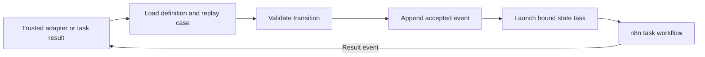

# Flow4Gold

An event-sourced state-machine runtime built as an n8n workflow. Define the process in JSON, implement its tasks as ordinary n8n workflows, and reconstruct each case from its accepted events.

The machine owns the process. n8n performs the work. AI can make bounded decisions inside a task, choosing among outcomes the current state permits.

## Why use it?

Processes such as refunds, approvals, and submissions outlive individual workflow executions. Flow4Gold makes their allowed transitions, current state, and history explicit, instead of spreading them across branching workflows and prompts.

- **One reusable core:** different processes share the same interpreter and event store.
- **Resumable cases:** an event starts a short runtime execution; another event can continue the case days later.
- **Traceable decisions:** accepted events explain how a case reached its state. Each case stays pinned to an immutable machine version.
- **Replaceable tasks:** change integrations, human review, or AI implementations through task bindings without putting them in the process definition.

## How the core works



[Core Runtime](workflows/flow4gold/core-runtime.workflow.ts) reads definitions from `machine_definitions` and history from `case_event_stream`. It validates each event against the reconstructed state, appends it, and optionally launches the entered state's task through `task_bindings`. Inspection and replay never execute tasks; identical event retries are no-ops.

The core has an internal subworkflow entry point. Domain adapters validate business evidence and control which events callers may submit. The supported model is intentionally small: flat states, explicit transitions, final outcomes, and one asynchronous task per entered state. See the [runtime contract](docs/runtime.md).

This is a base setup with demo integrations. Events must be submitted sequentially: n8n Data Tables do not provide atomic compare-and-append. Appending an event and launching its task are separate operations, with no automatic dispatch recovery.

## Included examples

The repository contains two machine JSONs:

- [Customer refund v1](machines/customer-refund.v1.json): bounded Jev diagnosis, Discord approval/review, and simulated refund execution.
- [Competition submission v1](machines/flow4gold-submission.v1.json): an external-event lifecycle for publication, review, finalist selection, and prize acceptance.

The local frontend includes payment support, sample orders, a machine editor, and contestant/admin views. The competition workbench, adapters and reference definition all use submission **v1**. See [example behavior and integration limits](docs/examples.md).

## Setup

Use Node.js 22.12+ with npm and an n8n instance supporting Data Tables.

```bash
npm ci
npm ci --prefix visualizer
npm run n8n -- env status --json
```

Configure the n8n environment, tables, workflow references, and credentials using the [setup guide](docs/setup.md). Workflow sources currently contain deployment-specific IDs, so a new instance needs those references mapped before use.

For a configured deployment, set `N8N_API_KEY` and `FLOW4GOLD_DEMO_TOKEN` in the ignored `.env` file, then run:

```bash
npm run demo
```

Open http://localhost:5173. The local bridge keeps credentials server-side. Use `npm run demo:api` if the frontend is already running.

## Development

```bash
npm run build              # Bundle runtime/task code into workflow sources
npm test                   # Runtime, adapter, and server checks
npm run validate           # Generated-source and n8n schema checks
npm run visualizer:test
npm run visualizer:build
npm run format:core:check
```

`runtime/` and `shared/` hold interpreter and task logic; `workflows/flow4gold/` holds deployable workflows; `server/` and `visualizer/` provide the local workbench. `npm run diagram -- machines/customer-refund.v1.json` generates a Mermaid diagram on demand.

Before workflow edits, follow [AGENTS.md](AGENTS.md): pull remote changes, preserve intended canvas positions with `npm run core:layout`, validate, and push only the intended source. Builds bundle code; they do not publish workflows or upload machine definitions.
