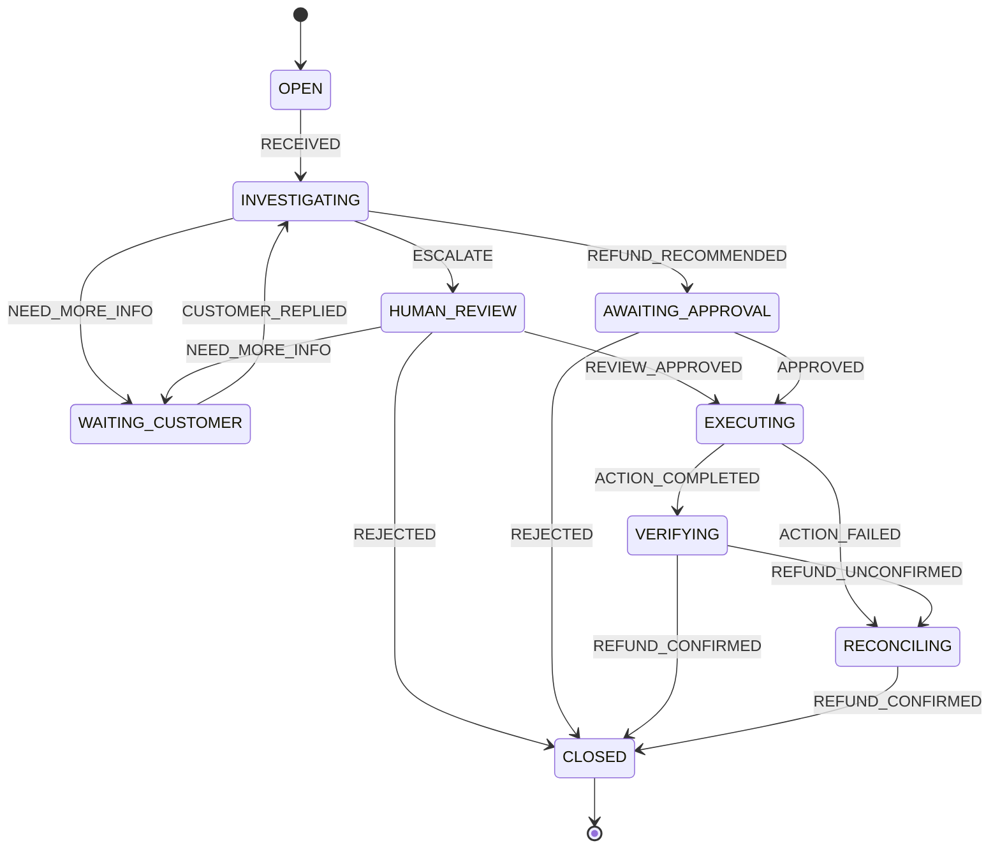

# Customer refund, version 3

New cases use [customer-refund.v3.json](../machines/customer-refund.v3.json). Versions 1 and 2 remain unchanged for existing streams. Version 3 makes human review actionable: approve a concrete refund, reject, or ask a customer question. The machine owns the allowed paths; task workflows implement the work.



For this small example, proposing a refund immediately enters `AWAITING_APPROVAL`; authoritative payment confirmation enters `CLOSED`. A human rejection also closes the simulated case. Every closing edge declares its outcome: `REJECTED` or `REFUNDED`.

## JSON contract

The top-level fields are `machine`, `version`, `initial`, and `states`. Each state can declare:

| Field | Meaning |
| --- | --- |
| `on` | External or task-result event names mapped to `{ "target": "STATE" }`. |
| `decide` | Semantic event names mapped to `{ "target": "STATE", "description": "..." }`. |
| `tasks` | Symbolic task names associated with entering the state. |
| `final` | `true` marks a terminal state without outgoing transitions or tasks. |

An edge may additionally declare `outcome`. In this machine, all edges to `CLOSED` carry an outcome; other edges do not. Replay derives this outcome from the closing event and its pinned machine version. The state name `CLOSED` alone does not explain why a case closed; the stream retains the event that determines the outcome.

For example:

```json
{
  "AWAITING_APPROVAL": {
    "on": {
      "APPROVED": { "target": "EXECUTING" },
      "REJECTED": { "target": "CLOSED", "outcome": "REJECTED" }
    }
  },
  "EXECUTING": {
    "tasks": ["issue_refund"],
    "on": {
      "ACTION_COMPLETED": { "target": "VERIFYING" },
      "ACTION_FAILED": { "target": "RECONCILING" }
    }
  }
}
```

Once an event is selected, its transition is deterministic. `decide` describes choices requiring interpretation, whether by a human, rules, or AI; diagnosis now uses Jev. Only those semantic choices should be presented to a decision engine. `on` and `decide` remain distinct even though both map events to a target.

Semantic choices are confined to investigation. `VERIFYING` receives `REFUND_CONFIRMED` or `REFUND_UNCONFIRMED` from an authoritative payment-status check, rather than asking AI whether the refund succeeded. `ACTION_COMPLETED` alone is not proof that money moved. The old `RESOLVED` and `NOT_RESOLVED` events are no longer accepted.

Version-3 tasks are `diagnose`, `request_approval`, `human_review`, `issue_refund`, and `verify_refund`. Version 2 has ordinary approval but no human-review task; version 1 has neither human task. These names contain no workflow IDs, API calls, prompts, or models. Loading the machine and inspecting tasks does not execute them.

## Persisted runtime

The runtime loads the saved definition from `machine_definitions`. The editor saves new immutable versions there; no workflow rebuild is needed just to store a definition. The source JSON files are seed/reference examples. See [machine editor and catalog](machine-editor.md).

The core workflow receives one event, rebuilds the case from its ordered stream, validates the new event against this machine, and appends the accepted event. Newly accepted events entering a task-bearing state resolve and invoke that task asynchronously. All five version-3 task workflows are implemented, with refund and verification explicitly simulated; diagnosis uses Jev, while replay itself never dispatches work or calls AI. Submit independent events sequentially; see the [event-sourcing contract](persistence.md). Keep this machine version immutable once it has recorded events, so replay remains deterministic.

Example happy path:

```text
OPEN --RECEIVED--> INVESTIGATING
     --REFUND_RECOMMENDED--> AWAITING_APPROVAL
     --APPROVED--> EXECUTING
     --ACTION_COMPLETED--> VERIFYING
     --REFUND_CONFIRMED--> CLOSED (outcome: REFUNDED)
```

`APPROVED` from `INVESTIGATING` is invalid. `CLOSED` accepts no events.

A legal transition is not proof of permission. Before exposing a real runtime, `APPROVED`, `REVIEW_APPROVED`, reviewer questions, and `REJECTED` need a trusted human path, and task-result events need a trusted task path. An incoming `source` field alone provides no authorization.

Version-2 approval refers to the immutable proposal event containing amount, currency, payment reference, and reason. The core requires the expected approval invocation and exact proposal event ID, both on submission and replay. The signed n8n form link is shared through the configured Discord webhook; it does not authenticate a named Discord approver. Legacy version-1 approval semantics are preserved. See [approval](approval.md).

`HUMAN_REVIEW` starts a Discord review task in version 3. `REVIEW_APPROVED` enters execution with an explicit approved proposal, `REJECTED` closes the case, and `NEED_MORE_INFO` carries the reviewer’s message into `WAITING_CUSTOMER`. Only `CUSTOMER_REPLIED` restarts investigation. The old `RESUME` event remains valid only in historical versions. See [human review](human-review.md). Failed or uncertain refund execution instead enters `RECONCILING`, which has no task or retry path. It waits for manual reconciliation against authoritative payment evidence. Only `REFUND_CONFIRMED` can close it, with outcome `REFUNDED`; a still-unconfirmed refund remains there. Safe retry behavior and duplicate protection must be designed before adding real side effects.
